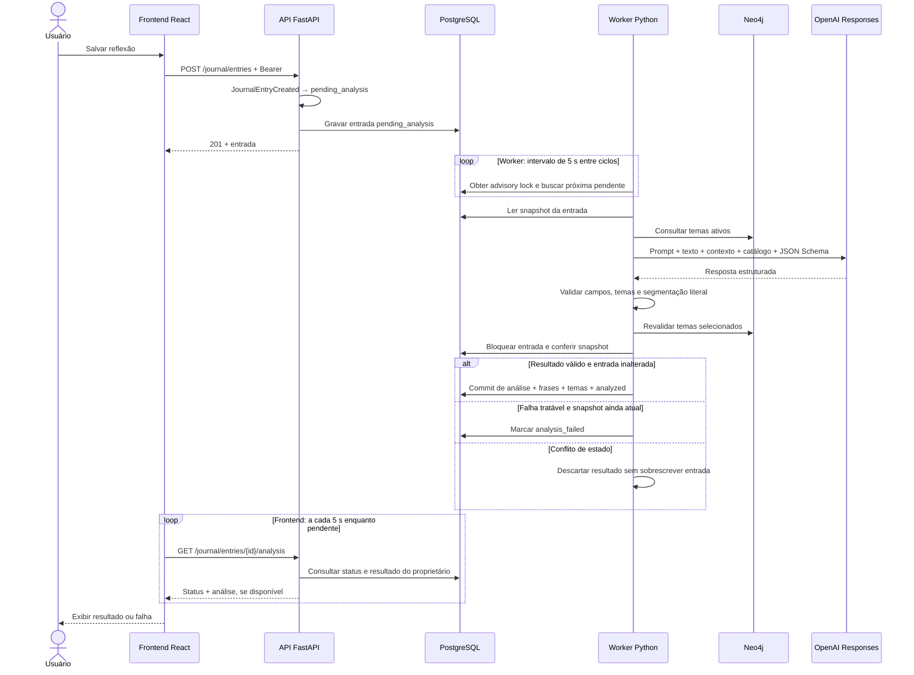
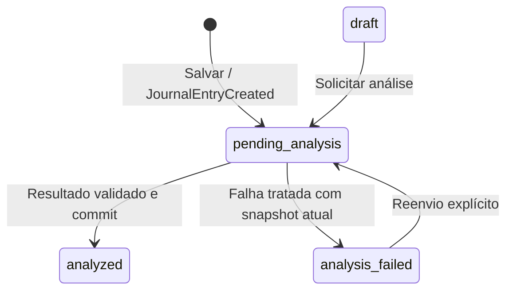

# Fluxo de análise de IA do diário — implementação atual

Verificado em 22/10/2026 na branch `UC34_#74`.

## Ambiente iniciado e validação

- Frontend: http://localhost:5173
- API/Swagger: http://localhost:8000/docs
- PostgreSQL: container `individuum-postgres-dev`, porta 5432.
- Neo4j: container `reflecta-neo4j-dev`, portas 7474/7687.
- Worker: `python -m src.modules.ai_processing.worker`, executado localmente na virtualenv do backend.
- Modelo configurado no teste: `gpt-6-luna`; configuração local atualizada para timeout de 60 segundos e limite de saída de 12.000 tokens.
- A configuração da IA é lida de `.env.dev` e `.env.ai.local`; o segundo arquivo sobrescreve o primeiro. Variáveis de ambiente têm precedência.
- Ajustado `FRONT_END_DOMAIN` no ambiente local para `http://localhost:5173`. API reiniciada com `DEBUG=false` e `SQL_ECHO=false`.
- Frontend, Swagger e preflight CORS responderam HTTP 200.
- 72 testes unitários de `tests/unit/ai_processing` passaram. Há avisos de depreciação do Pydantic.
- Chamada real com texto fictício: HTTP 200.
- Teste real pelo caso de uso de criação e worker: entrada `01M5JM87TN234MNDD1KTZSKPY1`, título **Teste da análise por IA**, conta administradora local. Resultado `analyzed`: 1 análise, 2 frases, 2 associações ao tema **Trabalho e carreira**.
- Esse teste integrado usa os casos de uso e a persistência reais, mas não substitui o teste manual de login e cliques no navegador.

**Migrations:** a cadeia foi reconciliada no UC18 (#14), incluindo as revisões de
`main` e a tabela de análises contextuais. Use `alembic upgrade head` no ambiente configurado.

## Como testar pela interface

1. Abra http://localhost:5173 e entre com sua conta existente.
2. Acesse http://localhost:5173/inicio/diario. Administradores também podem acessar essa URL diretamente, apesar do redirecionamento inicial ao painel administrativo.
3. Escreva uma reflexão fictícia de até **20.000 caracteres**, com título e contexto opcionais, e salve.
4. Acesse http://localhost:5173/inicio/reflexoes e abra a reflexão.
5. Ao salvar, a entrada entra automaticamente na fila de análise.
6. Acompanhe a fila e o resultado. A interface consulta a cada 5 segundos enquanto o status for `pending_analysis`.
7. Confira resumo, interpretação, sentimentos, tom, temas e frases destacadas. Recarregue a página para verificar que os dados foram persistidos.
8. Se aparecer `analysis_failed`, use **Solicitar análise novamente**. A reflexão permanece preservada, mas o fluxo atual só permite editar entradas em `draft`.

## Diagrama



## O que ocorre em cada etapa

### 1. Salvar aciona a análise automaticamente

`POST /journal/entries` cria uma entrada vinculada ao usuário autenticado. O evento interno `JournalEntryCreated` é tratado localmente antes da persistência e muda o estado de `draft` para `pending_analysis`. A entrada e o trabalho pendente são gravados no mesmo commit: não há janela entre salvar e enfileirar. O evento contém apenas identificadores e data; repetir seu tratamento não reinicia entradas pendentes, analisadas, com falha ou excluídas. O worker existente consome a fila após o commit; precisa estar ativo e configurado. Não há chamada ao provedor durante a requisição HTTP.

Cadastro, solicitação manual e processamento aceitam até **20.000 caracteres**. Novas entradas não ficam disponíveis para edição após salvar; a tela informa isso antes do envio. Entradas antigas em `draft` mantêm o envio manual.

### 2. Solicitação e fila durável

`POST /journal/entries/{id}/analysis` consulta uma entrada não excluída, pertencente ao usuário, e bloqueia a linha durante a atualização. Aceita `draft`, `analysis_failed` e `pending_analysis`. Repetir a solicitação de uma entrada já pendente não cria outra entrada na fila. Entradas analisadas geram conflito 409.

O retorno **202** confirma a solicitação, não uma análise concluída. A fila é o conjunto de entradas com `status=pending_analysis` no PostgreSQL. Não há SNS, SQS, RabbitMQ, outbox ou S3 nesse caminho específico.

### 3. Worker

O worker usa o advisory lock PostgreSQL de sessão `190024`. Isso serializa workers que respeitem o mesmo lock. Não mantém uma transação aberta durante a chamada de IA, mas mantém a conexão que possui o lock.

Busca uma pendente por vez, ordenada por criação e ID, excluindo entradas logicamente apagadas. Depois de cada ciclo espera 5 segundos. Esse intervalo soma-se ao tempo de processamento; não é uma promessa de início ou término em 5 segundos.

A configuração da IA é conferida antes do loop. Uma configuração ausente pode impedir o worker de iniciar, enquanto a API continua aceitando solicitações.

### 4. Prompt, catálogo e provedor

`InterpretEntry` relê a entrada e recebe do Neo4j somente os temas ativos. A OpenAI recebe o conteúdo textual, as tags de contexto e o catálogo, além do prompt do arquivo `reflecta_analysis_prompt.md` e do JSON Schema estrito.

Título, senha e token de login não são campos do payload de análise. O texto pode conter dados pessoais escritos pelo usuário e é enviado ao provedor. A requisição define `store=false`.

A resposta exige `summary`, `main_message`, `themes`, `sentiments`, `tone` e `sentences`. A interpretação exibida usa o campo `main_message`. A confiança deve estar entre 0 e 1. Catálogo vazio e listas de temas vazias são situações válidas.

### 5. Validação e gravação

O backend verifica estrutura e tipos, campos adicionais, limites de tamanho, confiança, IDs válidos e ausência de IDs duplicados nas seleções. Temas por frase devem estar na seleção geral.

Cada frase deve ser literal e estar na ordem do texto. O backend calcula os offsets por busca no conteúdo original, rejeita trechos alterados, lacunas com conteúdo e conteúdo final não segmentado. Apenas espaços entre segmentos podem ser omitidos. Reconsulta o catálogo e rejeita temas selecionados que tenham sido alterados ou desativados durante a chamada.

No PostgreSQL, relê e bloqueia a entrada, compara o snapshot e verifica se já existe análise concluída. Grava análise, frases, associações e status `analyzed` na mesma transação. Falha de commit faz rollback; não deve deixar análise parcial.

Cores, nomes e descrições vêm do catálogo, e não da resposta da IA. Sentimentos são normalizados para minúsculas e deduplicados. Temas gerais que não aparecem em nenhuma frase são retirados dos metadados finais.

### 6. Exibição e estados



O frontend lê a análise pela API; não chama a OpenAI diretamente. Usa offsets e temas para destacar o texto e exibe resumo, interpretação, tom e sentimentos. Uma falha de rede na consulta não significa necessariamente falha no processamento.

## Casos de falha identificados no código atual

A lista cobre as condições identificáveis nesta implementação; problemas externos de sistema operacional, rede e serviços não formam uma lista finita.

| Etapa / condição | Efeito atual | Como investigar ou agir |
| --- | --- | --- |
| API fora do ar, URL incorreta, CORS incorreto | Login, gravação, solicitação ou consulta falham no navegador | Conferir URLs, serviço e `FRONT_END_DOMAIN` |
| Token ausente, inválido ou expirado | Requisição não autorizada; frontend limpa sessão em 401 | Fazer login novamente |
| Entrada inexistente, excluída ou de outro usuário | 404; não solicita nem entrega análise | Conferir conta e ID |
| ID fora do formato/tamanho validado pela rota | 422 | Usar ID retornado pela API |
| Texto vazio ou com mais de 20.000 caracteres após trim | Solicitação retorna 400; não entra na fila | Ajustar enquanto ainda for draft |
| Entrada já analisada ou estado inelegível | 409 | Não há reanálise de entrada concluída nesse fluxo |
| Erro PostgreSQL durante a solicitação | Sem confirmação confiável; pode retornar erro | Consultar estado antes de repetir |
| Worker parado ou iniciado em ambiente/banco errado | Entrada permanece pendente | Conferir processo e configuração |
| Chave ou modelo vazio; configuração inválida | Worker não inicia ou termina; pendente permanece | Conferir `.env.ai.local`, sem publicar segredos |
| Outro worker detém o advisory lock | Este worker não processa naquele ciclo | Espera normal; investigar se o outro processo travou |
| PostgreSQL indisponível ao adquirir lock ou buscar fila | Exceção fora do tratamento por entrada pode encerrar o worker | Corrigir banco e reiniciar worker |
| Neo4j inacessível, autenticação inválida ou erro ao ler temas | Normalmente marca `analysis_failed`, se PostgreSQL disponível e snapshot atual | Conferir conexão do catálogo |
| Entrada inválida detectada no worker | Sem chamada útil de IA; marca falha quando possível | Conferir conteúdo e integridade da entrada |
| DNS, TLS, conexão, timeout HTTP ou timeout total | `InterpretationFailedError`; marca falha quando possível | Conferir rede, timeout e provedor |
| HTTP de erro do provedor, inclusive 400/401/403/404/429/5xx | Mesmo erro genérico de interpretação | Verificar chave, acesso ao modelo, parâmetros, limites, saldo/quota e disponibilidade |
| Resposta não concluída, truncada ou orçamento de tokens insuficiente | Falha de interpretação | Conferir orçamento de saída; não presumir sucesso por HTTP 200 |
| Recusa do modelo ou resposta sem texto | Falha de interpretação | Revisar entrada e diagnóstico do provedor |
| JSON inválido ou incompatível com schema no adaptador OpenAI | Convertido em erro genérico; sem retry automático desse caso | Conferir contrato e orçamento de resposta |
| Campos vazios, extras ou com tipo/tamanho inválido | Resultado rejeitado | Conferir schema e prompt |
| Mais de 100 temas por seleção, 20 sentimentos ou 500 frases; nenhuma frase | Resultado rejeitado pelo schema | Reduzir complexidade ou revisar limites |
| Confiança fora de 0–1 ou não finita | Resultado rejeitado | Conferir saída |
| Tema inexistente/inativo ou ID duplicado na seleção | `InvalidInterpretationError` | Conferir catálogo e seleção |
| Tema da frase ausente da seleção geral | `InvalidInterpretationError` | Conferir coerência entre níveis |
| Frase corrigida, inventada, traduzida, fora de ordem ou com conteúdo omitido | `InvalidInterpretationError` | Conferir segmentação literal |
| Tema selecionado mudou durante o processamento | `InvalidInterpretationError` | Evitar editar catálogo durante teste; reenviar |
| Entrada mudou ou já foi analisada durante a chamada | `AnalysisConflictError`; descarta resultado sem sobrescrever | Consultar estado atual; não é necessariamente falha |
| Entrada foi excluída durante a chamada | Resultado não é gravado; atualização de falha exclui apagadas | Comportamento esperado para entrada removida |
| Erro ao inserir análise/frases/temas ou confirmar transação | Rollback; tenta marcar falha em outra transação | Conferir schema, constraints, permissões e disponibilidade |
| PostgreSQL também falha ao marcar `analysis_failed` | Worker pode encerrar e entrada permanecer pendente | Corrigir banco e reiniciar |
| Snapshot mudou antes de marcar falha | UPDATE de falha não altera a entrada | Proteção contra sobrescrita de uma versão mais nova |
| Worker encerrado, cancelado ou máquina suspensa durante processamento | Pode permanecer pendente; transação não concluída não salva análise | Reiniciar; trabalho pode ser reenviado ao provedor |
| Resposta perdida após cobrança da chamada | Análise pode não ser salva; novo processamento pode gerar outra chamada | Não há chave de idempotência externa neste código |
| GET do resultado falha por rede, API, sessão ou banco | Frontend pode mostrar erro mesmo com análise salva | Reabrir “Ver análise” e conferir estado |
| Offsets incompatíveis na apresentação | Destaques inconsistentes são evitados pelos helpers; pode mostrar texto sem realce | Não confundir falha de destaque com falha da IA |

### Retry: o detalhe importante

O worker faz **no máximo duas tentativas** quando recebe `InvalidInterpretationError` do caso de uso: a primeira tentativa e uma repetição. Isso cobre, por exemplo, segmentação literal incorreta e temas inválidos.

Não há retry automático de transporte, timeout ou erro HTTP. Além disso, o adaptador OpenAI converte erros de JSON/schema em `InterpretationFailedError`, não em `InvalidInterpretationError`: esses erros também não entram na repetição automática atual. Após falha marcada, o usuário pode solicitar até três reprocessamentos por entrada. Se o terceiro também falhar, somente um administrador pode solicitar outro. O contador não inclui a análise inicial nem as repetições internas do worker.

Configuração ausente é propagada e pode encerrar o worker. Conflitos são descartados. A operação de marcar falha só atualiza uma entrada ainda pendente, não excluída e com o mesmo `updated_at` do snapshot. Portanto, nem todo erro termina em `analysis_failed`.

### Limitações de diagnóstico e qualidade

- Há uma entrada antiga em falha, `01M4K02E5QWW3350B6J7XPTP2C`, atualizada em 10/10/2026. Não foi reprocessada automaticamente.
- O worker agora cria um registro `failed` em `journal_schema.analysis`, com JSON em `analysis_error`: `code`, `message` e `attempts`. A mensagem vem de uma lista fixa, sem texto do diário ou respostas brutas do provedor. O log inclui o código. Falhas antigas continuam sem causa recuperável. O histórico é preservado após nova solicitação e sucesso; a consulta pública continua entregando somente análises concluídas.
- O prompt exige fidelidade, português, ausência de diagnóstico e confiança mínima de 0,65 para associações. As validações determinísticas não comprovam qualidade semântica, idioma ou cumprimento clínico; o schema aceita confiança de 0 a 1. Uma análise pode passar tecnicamente e ainda exigir avaliação humana.
- Não existe prazo máximo da fila nem mensagem distinta para worker parado. `pending_analysis` pode permanecer indefinidamente em problemas de infraestrutura.

## Comandos para repetir a execução local

Na raiz, se os containers já existem:

```sh
docker start individuum-postgres-dev reflecta-neo4j-dev
```

Em um terminal em `Codigo/BACK`:

```sh
DEBUG=false SQL_ECHO=false FRONT_END_DOMAIN=http://localhost:5173 POSTGRES_HOST=localhost .venv/bin/python -m uvicorn src.main.server.fast_api.run:app --host 0.0.0.0 --port 8000
```

Em outro terminal em `Codigo/BACK`:

```sh
DEBUG=false SQL_ECHO=false POSTGRES_HOST=localhost .venv/bin/python -m src.modules.ai_processing.worker
```

Em um terminal em `Codigo/FRONT`:

```sh
npm run dev -- --host 0.0.0.0 --port 5173 --strictPort
```

Não execute outra instância na mesma porta se a atual já estiver funcionando. O worker executado diretamente no host não tem reinício automático.

## Fontes no repositório

- `Codigo/FRONT/src/components/journal/JournalAnalysis.jsx`
- `Codigo/FRONT/src/services/journalApi.js`
- `Codigo/BACK/src/modules/journal/presentation/routes.py`
- `Codigo/BACK/src/modules/journal/infrastructure/persistence/postgresql/analysis_gateway.py`
- `Codigo/BACK/src/modules/ai_processing/worker.py`
- `Codigo/BACK/src/modules/ai_processing/application/interpret_entry.py`
- `Codigo/BACK/src/modules/ai_processing/application/contracts.py`
- `Codigo/BACK/src/modules/ai_processing/application/reflecta_analysis_prompt.md`
- `Codigo/BACK/src/modules/ai_processing/infrastructure/openai_interpreter.py`
- `Codigo/BACK/src/modules/catalog/public/analysis_catalog.py`


## Atualização: catálogo e consulta HTTP de falhas

Foram cadastrados sete temas adicionais, totalizando 62 temas ativos no ambiente
local. Novas análises leem o catálogo atualizado; resultados concluídos permanecem
inalterados. O lote está em `Codigo/BACK/postman/Reflecta-Novos-Temas.json`.

O endpoint `GET /journal/entries/{journalId}/analysis/failures?limit=20` permite ao
proprietário consultar histórico e motivo das falhas. O retorno indica
`can_reprocess` para entradas atualmente em `analysis_failed`. O reenvio continua
sendo `POST /journal/entries/{journalId}/analysis`, sem body. A collection separada
e os cURLs estão em `Codigo/BACK/postman/Diagnostico-e-Reprocessamento.md`.


## Consulta administrativa de falhas — UC32 / #29

Motivos técnicos são exclusivos de administradores, inclusive no endpoint legado
`/journal/entries/{id}/analysis/failures`. O usuário comum mantém consulta de
estado/resultado e solicitação de nova tentativa, sem receber diagnóstico.
Consulte `Documentacao/falhas-operacionais.md` para origens, filtros e detalhes.


O limite e o reprocessamento administrativo do UC33 estão documentados em
`Documentacao/reprocessamento-controlado.md`.
